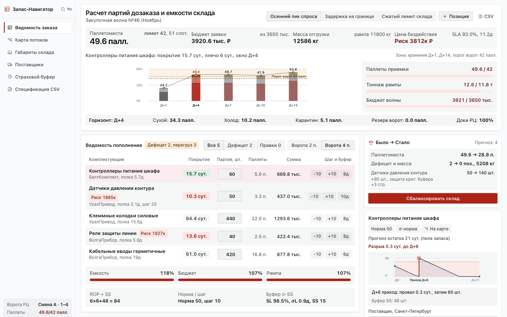
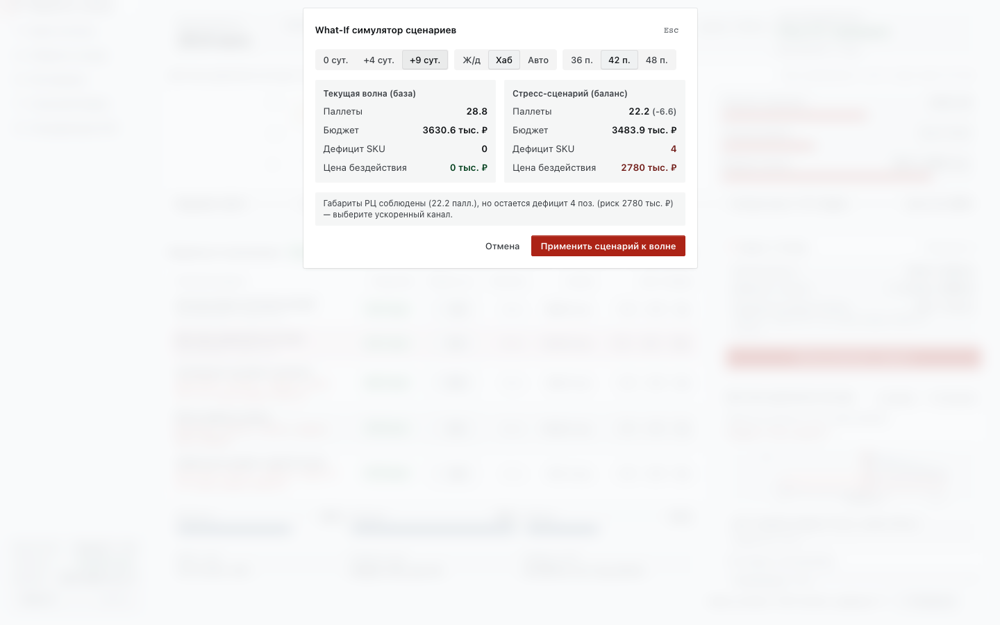

# СППР «Запас-Навигатор» (v1.5 Prescriptive DSS)

Интеллектуальная система поддержки принятия решений по управлению многономенклатурными запасами, прогнозированию спроса, многокритериальному отбору поставщиков и балансировке закупочных волн для производственных и оптово-дистрибьюторских предприятий (Университет ИТМО, гр. К4140, Звездаков А.В.).



## Ключевые документы и артефакты

- **Паспорт СППР по стандарту ИТМО / ГОСТ 7.32-2017 (33 с., А4):**
  - [`inventory_dss/docs/Паспорт_СППР_Запас_Навигатор_ИТМО.pdf`](inventory_dss/docs/Паспорт_СППР_Запас_Навигатор_ИТМО.pdf)
  - [`inventory_dss/docs/Паспорт_СППР_Запас_Навигатор_ИТМО.docx`](inventory_dss/docs/Паспорт_СППР_Запас_Навигатор_ИТМО.docx)
- **Детальный паспорт 8 практик и математических расчётов:** [`inventory_dss/docs/PASSPORT_DSS.md`](inventory_dss/docs/PASSPORT_DSS.md)
- **Конкурентный анализ рынка:** [`inventory_dss/docs/COMPETITIVE_ANALYSIS.md`](inventory_dss/docs/COMPETITIVE_ANALYSIS.md)
- **Продуктовая и архитектурная документация веб-терминала:** [`inventory_dss_swiss_workbench/docs/PRODUCT.md`](inventory_dss_swiss_workbench/docs/PRODUCT.md)
- **Видеодемонстрация работы веб-терминала:** [`inventory_dss_swiss_workbench/docs/demo/zapas_navigator_demo.mp4`](inventory_dss_swiss_workbench/docs/demo/zapas_navigator_demo.mp4)



---

## Архитектура репозитория

| Директория | Назначение | Технологический стек |
| :--- | :--- | :--- |
| [`inventory_dss/`](inventory_dss/) | Расчётное аналитическое ядро СППР: генератор данных (25 SKU, 730 дней), AHP + энтропия Шеннона + TOPSIS, дерево решений EMV / Вальда / Сэвиджа / Гурвица / Лапласа, оптимизация EOQ + тождество Вальда + KKT (SLSQP), продукционная база знаний XAI, турнир прогнозных моделей (RidgeRegression, Holt-Winters, Croston) и 5-экранный BI-дашборд | Python 3.13+, Pydantic v2, SciPy, scikit-learn, statsmodels, Streamlit, Plotly, `uv`, `pytest` |
| [`inventory_dss_swiss_workbench/`](inventory_dss_swiss_workbench/) | Предписывающий веб-терминал **«Запас-Навигатор» v1.5**: 6 интерактивных экранов (`Alt+1..6`), командная палитра (`Ctrl+K`), учёт дискретных слотов рампы WMS, расчёт цены бездействия (*Cost of Inaction*), переговорный TCO-калькулятор, изолированный симулятор стресс-сценариев **What-If Split-Screen** (`Alt+S`), выгрузка в 1С:ERP / SAP MM (CSV RFC 4180 и записка OData) | TypeScript, React 18, Vite 6, CSS Custom Properties (OKLCH), Zero-Backend / Local-First |

---

## Быстрый старт

### 1. Аналитическое ядро и Streamlit BI (`inventory_dss`)

```bash
cd inventory_dss
uv sync
uv run pytest -v
uv run streamlit run src/inventory_dss/ui/app.py --server.port 8501
```

### 2. Предписывающий веб-терминал (`inventory_dss_swiss_workbench`)

```bash
cd inventory_dss_swiss_workbench
npm install
npm run typecheck
npm run dev
```

Автономная однофайловая сборка доступна без запуска сервера в [`inventory_dss_swiss_workbench/dist/index.html`](inventory_dss_swiss_workbench/dist/index.html).
